# SAAX Commitment Lifecycle

This document is the canonical state machine for a SAAX commitment. It defines every state, every valid transition, the trigger conditions for each transition, the terminal states, how recovery states resolve, and a state diagram.

## 1. States

| State | Phase | Description |
|---|---|---|
| `issued` | active | Commitment created, parties identified, terms set; awaiting authority validation if an authority reference is present |
| `authority_validated` | active | External authority proof validated (structure, signature, scope, time); commitment authorized |
| `accepted` | active | All required parties have signed; commitment is executable |
| `in_flight` | active | Merchant received the commitment and is processing it; the outcome is not yet known to the calling agent |
| `executing` | active | Provider is executing the obligation |
| `evidence_pending` | active | Execution complete; awaiting evidence submission |
| `evidence_submitted` | active | Evidence received; awaiting verification |
| `verifying` | active | Evidence being evaluated against acceptance criteria and verification policies |
| `fulfilled` | **terminal** | All acceptance criteria satisfied; outcome verified |
| `failed` | **terminal** | Irrecoverable failure |
| `recovering` | active | Failure detected; recovery policy in progress (retry, refund, re-plan) |
| `disputed` | active | A party raised a dispute; resolution in progress |
| `settled` | terminal transition | Settlement linked and executed against the settlement requirement (R) |
| `finalized` | **terminal** | Commitment conclusively terminal: settled + audited + resolution recorded |
| `cancelled` | **terminal** | Commitment voided before execution by mutual agreement or policy |
| `expired` | **terminal** | Deadline passed without fulfillment; terminal by time |

## 2. Valid transitions

| From | To | Trigger condition |
|---|---|---|
| `issued` | `authority_validated` | An authority reference exists and the proof validates (structure, signature, scope, time) |
| `issued` | `accepted` | No authority reference (legacy path): buyer signature is the authorization; all parties signed |
| `issued` | `cancelled` | Mutual cancellation before acceptance; policy cancel |
| `issued` | `expired` | Deadline passes before acceptance |
| `authority_validated` | `accepted` | All parties signed |
| `authority_validated` | `failed` | Authority proof invalid at evaluation time (expired / out of scope / bad signature) |
| `authority_validated` | `expired` | Deadline passes after validation but before acceptance |
| `accepted` | `executing` | Provider signals start of execution |
| `accepted` | `in_flight` | Merchant receives the commitment creation request; the in_flight write is the durable lock |
| `in_flight` | `executing` | Merchant begins fulfillment |
| `in_flight` | `failed` | Merchant's processing fails |
| `in_flight` | `expired` | Merchant's processing window closes without resolution |
| `accepted` | `cancelled` | Cancellation before execution starts |
| `accepted` | `expired` | Deadline passes before execution begins |
| `executing` | `evidence_pending` | Provider reports obligation complete |
| `executing` | `recovering` | Failure condition met during execution (partial failure, timeout candidate) |
| `executing` | `failed` | Irrecoverable execution failure |
| `executing` | `expired` | Deadline passes mid-execution with no path to completion |
| `evidence_pending` | `evidence_submitted` | Evidence payload received and structurally valid |
| `evidence_pending` | `recovering` | Evidence window lapsed; recovery policy applies |
| `evidence_pending` | `failed` | No evidence by deadline and no recovery available |
| `evidence_submitted` | `verifying` | Verification begins |
| `evidence_submitted` | `disputed` | Party disputes evidence contents |
| `verifying` | `fulfilled` | All criteria satisfied (each policy outcome `satisfied`) |
| `verifying` | `recovering` | Outcome `insufficient_evidence`; recovery allows resubmission/retry |
| `verifying` | `failed` | Any criterion `not_satisfied` or `insufficient_evidence` with no recovery path |
| `fulfilled` | `settled` | Settlement requirement (R) is realised and settled through a registered rail |
| `fulfilled` | `disputed` | Post-fulfillment dispute (e.g., quality at verification edges) |
| `recovering` | `executing` | Retry authorized (within `recoveryPolicy.maxRetries`) |
| `recovering` | `evidence_pending` | Resubmission window reopened |
| `recovering` | `failed` | Retry budget exhausted; refunds/compensation applied per policy |
| `recovering` | `fulfilled` | Recovery action achieved fulfillment (partial credit path) |
| `disputed` | `executing` | Dispute resolved in favor of continuation |
| `disputed` | `recovering` | Dispute resolved to recovery (re-work / partial credit) |
| `disputed` | `fulfilled` | Dispute resolved; criteria satisfied |
| `disputed` | `failed` | Dispute resolved against the commitment |
| `disputed` | `settled` | Dispute resolved to settlement of agreed amounts |
| `settled` | `finalized` | Audit chain complete; final resolution recorded |
| `settled` | `disputed` | Settlement disputed (chargeback / mis-settlement) |
| `expired` | (terminal) | No outgoing transitions |
| `failed` | (terminal) | No outgoing transitions |
| `cancelled` | (terminal) | No outgoing transitions |
| `finalized` | (terminal) | No outgoing transitions |

## 3. Terminal states

- **`fulfilled`** — outcome verified against every acceptance criterion.
- **`failed`** — irrecoverable failure; recovery exhausted or unavailable.
- **`cancelled`** — voided before execution.
- **`expired`** — deadline passed without fulfillment.
- **`finalized`** — conclusive terminal state after settlement and audit.

Note: `settled` is a settlement-boundary state (terminal for the payment aspect) that advances to `finalized` once the audit chain closes. Implementations may treat `settled` as terminal only after `finalized`.

## 4. Recovery states and resolution

`recovering` is the single recovery state. It is entered from `executing`, `evidence_pending`, `verifying`, or `disputed` when a failure condition or `insufficient_evidence` outcome triggers the commitment's recovery policy. Resolution:

1. If `recoveryPolicy.maxRetries > 0` and retries remain, return to `executing` (re-work) or `evidence_pending` (resubmission).
2. If retries are exhausted or no retry is configured:
   - `refundOnFailure` applies refunds per `refundsCompensation`;
   - partial completion applies partial credit;
   - the commitment transitions to `failed` (terminal).
3. If a recovery action achieves fulfillment, transition to `fulfilled` (partial-credit path).

Recovery is standardized in structure; enforcement and arbitration are the parties' responsibility (see the recovery disclaimer on the landing page).

## 5. State diagram (Mermaid)

```mermaid
stateDiagram-v2
    [*] --> issued
    issued --> authority_validated: authority proof valid
    issued --> accepted: no authority ref; all signed
    issued --> cancelled: mutual cancel
    issued --> expired: deadline passes
    authority_validated --> accepted: all parties signed
    authority_validated --> failed: proof invalid at exec time
    authority_validated --> expired: deadline passes
    accepted --> executing: provider starts
    accepted --> in_flight: merchant receives (durable lock)
    in_flight --> executing: merchant starts fulfillment
    in_flight --> failed: processing fails
    in_flight --> expired: window closes without resolution
    accepted --> cancelled: cancel before start
    accepted --> expired: deadline passes
    executing --> evidence_pending: obligation complete
    executing --> recovering: failure condition
    executing --> failed: irrecoverable
    executing --> expired: deadline mid-execution
    evidence_pending --> evidence_submitted: evidence received
    evidence_pending --> recovering: window lapsed
    evidence_pending --> failed: no evidence by deadline
    evidence_submitted --> verifying: verification begins
    evidence_submitted --> disputed: party disputes
    verifying --> fulfilled: all criteria satisfied
    verifying --> recovering: insufficient_evidence
    verifying --> failed: not_satisfied / no recovery
    fulfilled --> settled: settlement realised
    fulfilled --> disputed: post-fulfillment dispute
    recovering --> executing: retry authorized
    recovering --> evidence_pending: resubmission
    recovering --> failed: retries exhausted
    recovering --> fulfilled: recovery fulfils
    disputed --> executing: resolve to continue
    disputed --> recovering: resolve to rework
    disputed --> fulfilled: resolve satisfied
    disputed --> failed: resolve against
    disputed --> settled: resolve to settle
    settled --> finalized: audit complete
    settled --> disputed: settlement disputed
    fulfilled --> [*]
    failed --> [*]
    cancelled --> [*]
    expired --> [*]
    finalized --> [*]
```

## 6. Conformance

Lifecycle transition test vectors live in the [conformance suite](../conformance). A conforming implementation must accept exactly the valid transitions above and reject every other transition with the canonical state error (`ST_*`, see `error-codes.md`).